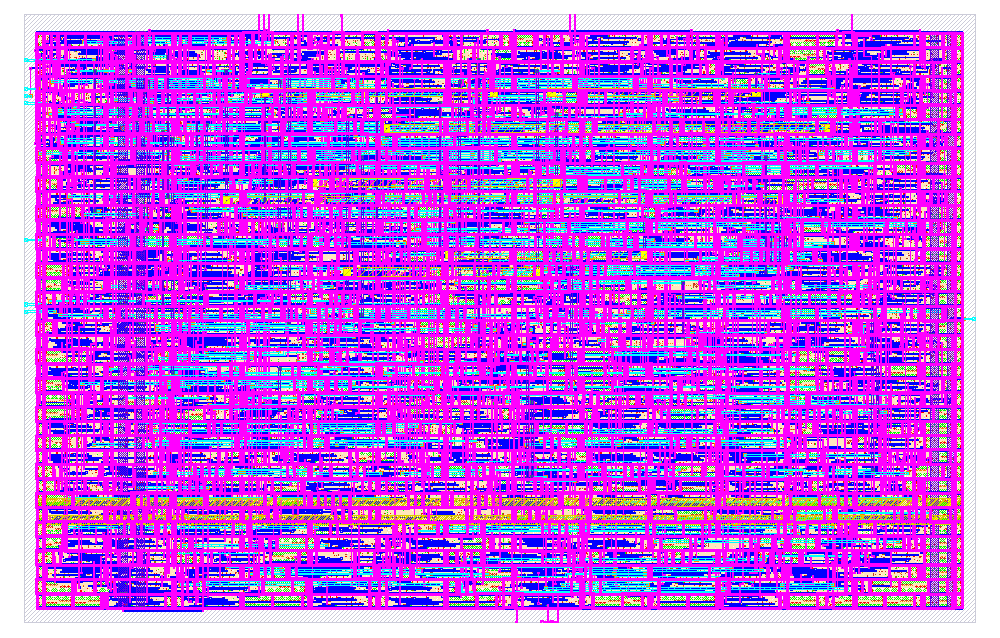
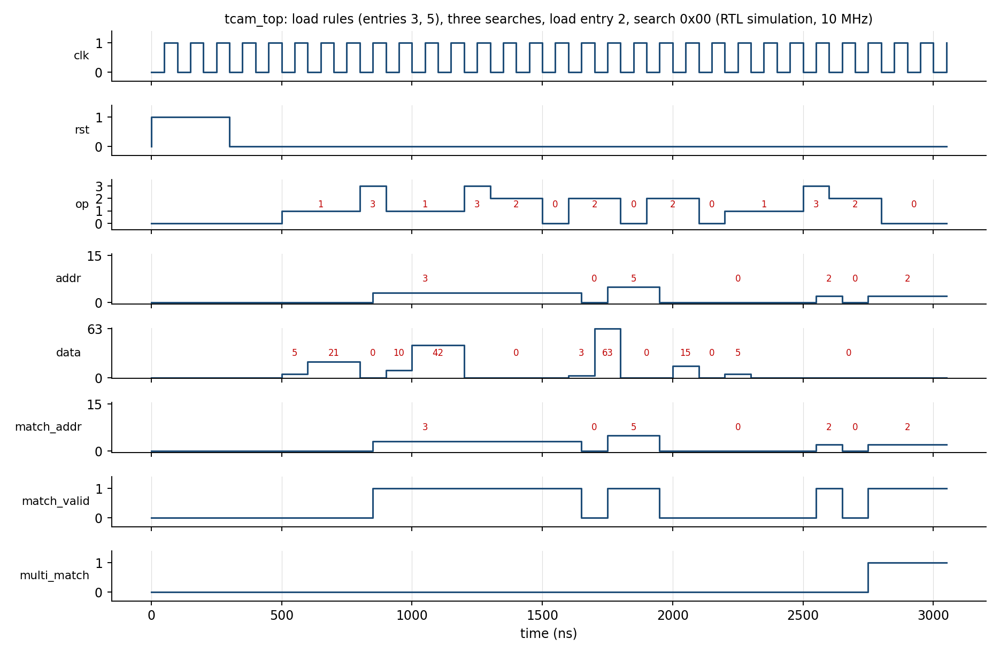

<p align="center">
  
</p>

<h1 align="center">16 × 8 Ternary Content-Addressable Memory (TCAM)<br>with Priority Encoder</h1>

<p align="center">
  <b>Silicluster v3 · Digital · SkyWater SKY130 · 1.8 V</b>
</p>

<p align="center">
  
  
  
  
  
  
  
</p>

---

## Table of Contents

- [Overview](#overview)
- [Key Features](#key-features)
- [Architecture](#architecture)
- [Pin Interface](#pin-interface)
- [Cell Encoding](#cell-encoding)
- [Operation Protocol](#operation-protocol)
  - [Writing a Rule](#writing-a-rule)
  - [Searching](#searching)
- [Directory Structure](#directory-structure)
- [Getting Started](#getting-started)
  - [Prerequisites](#prerequisites)
  - [Simulation](#simulation)
  - [Synthesis](#synthesis)
  - [Physical Design (OpenLane)](#physical-design-openlane)
- [Simulation Waveform](#simulation-waveform)
- [Signoff Results](#signoff-results)
- [Authors](#authors)
- [License](#license)

---

## Overview

This project implements a **16-entry × 8-bit Ternary Content-Addressable Memory (TCAM)** with an integrated combinational **priority encoder** (lowest matching index wins) and a **multi-match flag**. Each stored bit supports ternary states — `0`, `1`, or `X` (don't-care / wildcard) — enabling flexible pattern matching for applications such as network packet classification, lookup tables, and access-control lists.

Rules and search words are loaded serially through a compact **6-bit data bus**, allowing the entire design to fit within **14 input pins** and **6 output pins**. The design is written in **pure synthesizable Verilog-2001**, operates on a **single clock domain**, and uses a **synchronous active-high reset**.

> **Target Technology:** SkyWater SKY130 (`sky130A`, `sky130_fd_sc_hd` standard-cell library, 1.8 V, ≤ 10 MHz)

---

## Key Features

| Feature | Detail |
|---|---|
| **TCAM Depth** | 16 entries |
| **Search Width** | 8 bits |
| **Ternary Support** | Each bit can be `0`, `1`, or `X` (don't-care) |
| **Priority Encoder** | Combinational; returns lowest matching index |
| **Multi-Match Detection** | Hardware flag when ≥ 2 entries match |
| **Serial Loading** | 6-bit data bus — fits in 14 total input pins |
| **Clock** | Single clock, ≤ 10 MHz |
| **Reset** | Synchronous, active-high; invalidates all entries |
| **Technology** | SKY130 (`sky130_fd_sc_hd`), 1.8 V |
| **Die Area** | 180 µm × 115 µm (~20,700 µm²) |
| **Instance Count** | ~2,331 standard cells |
| **Flip-Flops** | ~296 (256 storage + 16 valid + 24 load registers) |
| **No SRAM Macro** | Fully register-based storage |

---

## Architecture

The design is composed of three modules instantiated inside the top-level wrapper `tcam_top`:

```
┌─────────────────────────────────────────────────────────────┐
│                        tcam_top                             │
│                                                             │
│  ┌──────────────┐   ┌──────────────┐   ┌────────────────┐  │
│  │  tcam_ctrl   │──▶│  tcam_array   │──▶│priority_encoder│  │
│  │              │   │              │   │                │  │
│  │ • Op decode  │   │ • 16×16-bit  │   │ • 16→4 encode │  │
│  │ • Rule shift │   │   register   │   │ • valid flag   │  │
│  │   register   │   │   file       │   │ • multi_match  │  │
│  │ • Search     │   │ • Ternary    │   │   detection    │  │
│  │   register   │   │   match      │   │                │  │
│  └──────────────┘   │   logic      │   └────────────────┘  │
│                     │ • Valid bits  │                        │
│                     └──────────────┘                        │
└─────────────────────────────────────────────────────────────┘
```

| Module | File | Description |
|---|---|---|
| `tcam_top` | `rtl/tcam_top.v` | Top-level wrapper; instantiates and connects all sub-modules |
| `tcam_ctrl` | `rtl/tcam_ctrl.v` | Command decoder; manages rule shift register and search register |
| `tcam_array` | `rtl/tcam_array.v` | 16-entry × 16-bit register file with per-entry valid bits and ternary matchline logic |
| `priority_encoder` | `rtl/priority_encoder.v` | Combinational 16-to-4 priority encoder with multi-match detection |

---

## Pin Interface

**Total: 14 inputs (including `clk` and `rst`) · 6 outputs**

| Pin | Direction | Width | Description |
|:---:|:---------:|:-----:|:---|
| `clk` | Input | 1 | System clock (≤ 10 MHz) |
| `rst` | Input | 1 | Active-high synchronous reset; invalidates all entries |
| `op` | Input | 2 | Operation code — `00` NOP, `01` LOAD_RULE, `10` LOAD_SEARCH, `11` COMMIT |
| `addr` | Input | 4 | Entry address (used during COMMIT) |
| `data` | Input | 6 | Serial data chunk |
| `match_addr` | Output | 4 | Index of the lowest matching entry (`0` when no match) |
| `match_valid` | Output | 1 | High when at least one entry matches |
| `multi_match` | Output | 1 | High when two or more entries match |

---

## Cell Encoding

Each TCAM entry stores 8 ternary cells. Each cell is encoded as a 2-bit pair `{r1, r0}`:

| `{r1, r0}` | Meaning | Match Behavior |
|:-----------:|:--------|:---------------|
| `00` | **X** (don't-care) | Always matches |
| `01` | **Logic 0** | Matches when search bit = `0` |
| `10` | **Logic 1** | Matches when search bit = `1` |
| `11` | **Invalid** | Never matches |

Entry rule bits `[2j+1 : 2j]` correspond to search bit `j`. After reset, all entries are marked invalid (valid bit = `0`).

---

## Operation Protocol

All operations complete in a **single clock edge per step**. Signals are driven on the falling edge and sampled on the rising edge.

### Writing a Rule

To write a 16-bit rule `R[15:0]` into entry at address `A`:

| Cycle | `op` | `addr` | `data` | Action |
|:-----:|:----:|:------:|:------:|:-------|
| 1 | `01` | — | `{2'b00, R[15:12]}` | Load rule chunk 0 (MSBs) into shift register |
| 2 | `01` | — | `R[11:6]` | Load rule chunk 1 into shift register |
| 3 | `01` | — | `R[5:0]` | Load rule chunk 2 (LSBs) into shift register |
| 4 | `11` | `A` | — | **COMMIT** — write shift register to entry `A`, set valid |

### Searching

To search for an 8-bit word `S[7:0]`:

| Cycle | `op` | `data` | Action |
|:-----:|:----:|:------:|:-------|
| 1 | `10` | `{4'b0000, S[7:6]}` | Load search chunk 0 (MSBs) |
| 2 | `10` | `S[5:0]` | Load search chunk 1 (LSBs) |

Outputs (`match_addr`, `match_valid`, `multi_match`) are **valid immediately** after the second rising edge. Results persist during NOP (`op=00`) until the search register or a stored entry changes. Matching is **purely combinational**.

---

## Directory Structure

```
designs/
├── README.md                    # This file
├── config.json                  # OpenLane configuration
├── tcam_top_interface.v         # External port-only interface reference
├── render.py                    # KLayout GDS render helper script
├── collect_evidence.sh          # Collects layout + DRC/LVS evidence from a run
├── layout_render.png            # GDS layout render image
├── Simulation_and_Validation.pdf # Simulation & validation report
│
├── rtl/                         # RTL source files (synthesizable Verilog-2001)
│   ├── tcam_top.v               # Top-level module
│   ├── tcam_ctrl.v              # Command decoder & serial load registers
│   ├── tcam_array.v             # 16×8 ternary storage + matchline logic
│   └── priority_encoder.v       # 16-to-4 priority encoder with multi-match
│
├── sim/                         # Simulation & verification
│   ├── tb_tcam.v                # Self-checking testbench (directed + randomized)
│   ├── tb_wave.v                # Waveform-generation testbench
│   ├── run_sim.sh               # One-command simulation runner
│   ├── sim_log.txt              # Simulation output log
│   ├── wave.vcd                 # Value Change Dump (waveforms)
│   └── wave.png                 # Waveform screenshot
│
├── synthesis/                   # Synthesis scripts
│   ├── synth.ys                 # Yosys synthesis script (SKY130 mapped)
│   └── ff_map.v                 # Flip-flop tech-mapping cells
│
├── docs/                        # Documentation
│   └── pin_map.md               # Pin mapping reference
│
└── runs/                        # OpenLane run outputs
    └── RUN_2026-10-30_16-56-25/ # Latest signoff run (77-step flow)
        ├── final/               # Signoff outputs (GDS, LEF, DEF, netlists, metrics)
        ├── resolved.json        # Resolved configuration
        └── flow.log             # Full flow log
```

---

## Getting Started

### Prerequisites

| Tool | Purpose |
|---|---|
| [Icarus Verilog](http://iverilog.icarus.com/) (`iverilog`, `vvp`) | RTL simulation |
| [GTKWave](http://gtkwave.sourceforge.net/) *(optional)* | Waveform viewing |
| [Yosys](https://yosyshq.net/yosys/) | Logic synthesis |
| [OpenLane 2](https://github.com/efabless/openlane2) | Full RTL-to-GDSII flow |
| [SkyWater PDK](https://github.com/google/skywater-pdk) (`sky130A`) | Target process design kit |
| [KLayout](https://www.klayout.de/) *(optional)* | GDS viewing & DRC |

### Simulation

```bash
cd sim && bash run_sim.sh
```

**Expected output:**
```
PASS T0 empty after reset
PASS T1a exact 0x00 -> 3
PASS T1b exact 0xFF -> 5
PASS T1c 0x0F no match
PASS T2a wildcard hit
PASS T2b wildcard miss
PASS T3 priority -> 2
PASS T4a invalid cell skipped
PASS T4b all-X matches anything
PASS T5 overwrite entry 1 (no match)
PASS b overwritten entry matches 0xFF
PASS T6 reset clears entries
*** ALL TESTS PASSED (412 checks) ***
```

The testbench includes:
- **12 directed tests** — exact match, wildcard match, priority resolution, multi-match flag, invalid cell handling, entry overwrite, and reset behavior
- **400 randomized tests** — random rules and search words verified against an independent behavioral reference model

To generate waveforms for visual inspection:

```bash
cd sim
iverilog -g2005 -o sim_wave.vvp ../rtl/tcam_top.v ../rtl/tcam_ctrl.v \
    ../rtl/tcam_array.v ../rtl/priority_encoder.v tb_wave.v
vvp sim_wave.vvp
gtkwave wave.vcd      # opens waveform viewer
```

### Synthesis

```bash
cd synthesis
# Copy the SKY130 liberty file into the synthesis/ directory first:
# cp $PDK_ROOT/sky130A/libs.ref/sky130_fd_sc_hd/lib/sky130_fd_sc_hd__tt_025C_1v80.lib .
yosys synth.ys
```

This produces:
- `tcam_top_synth.v` — Gate-level netlist mapped to SKY130 standard cells
- `stat_sky130.txt` — Area and cell count statistics

> **Note:** This synthesis is for estimation only. The signoff netlist and metrics come from the full OpenLane flow.

### Physical Design (OpenLane)

The project includes a ready-to-use `config.json` for OpenLane 2:

```bash
# From inside the OpenLane/LibreLane environment:
flow.tcl -design /path/to/designs
```

**Key configuration highlights:**

| Parameter | Value |
|---|---|
| `DESIGN_NAME` | `tcam_top` |
| `PDK` | `sky130A` |
| `STD_CELL_LIBRARY` | `sky130_fd_sc_hd` |
| `CLOCK_PERIOD` | 100 ns (10 MHz) |
| `DIE_AREA` | `[0, 0, 180, 115]` µm |
| `CORE_AREA` | `[2, 2, 178, 113]` µm |
| `PL_TARGET_DENSITY` | 0.65 |
| `SYNTH_STRATEGY` | `AREA 3` |

---

## Simulation Waveform

<p align="center">
  
</p>

The waveform demonstrates: reset de-assertion → loading rules into entries 3 and 5 → three searches (`0x00`, `0xFF`, `0x0F`) → loading a wildcard rule into entry 2 → multi-match scenario.

---

## Signoff Results

The design has been taken through the **complete 77-step OpenLane flow** including synthesis, floorplanning, placement, CTS, routing, signoff STA, DRC, and LVS.

### Timing (Multi-Corner)

| Corner | Setup WNS | Setup TNS | Hold WNS | Hold TNS | Violations |
|:-------|:---------:|:---------:|:--------:|:--------:|:----------:|
| `tt_025C_1v80` (Typical) | 0 | 0 | 0 | 0 | ✅ None |
| `ss_100C_1v60` (Slow) | 0 | 0 | 0 | 0 | ✅ None |
| `ff_n40C_1v95` (Fast) | 0 | 0 | 0 | 0 | ✅ None |

### Physical Verification

| Check | Result |
|:------|:------:|
| **Magic DRC** | ✅ **0 errors** |
| **KLayout DRC** | ✅ **0 errors** |
| **LVS** (Netgen) | ✅ **Clean** — 0 device / net / property differences |
| **Antenna Violations** | ✅ **0 violations** |
| **Routing DRC** | ✅ **0 errors** (converged in 6 iterations) |

### Area & Power

| Metric | Value |
|:-------|:------|
| **Die Area** | 180 µm × 115 µm (20,700 µm²) |
| **Cell Instance Area** | 19,068.3 µm² |
| **Standard Cell Count** | 2,331 |
| **Total Routed Wirelength** | 33,661 µm |
| **Total Power** | 265.5 µW @ 10 MHz |
| **Leakage Power** | 13.5 nW |

---

## Collecting Evidence

To package layout files and DRC/LVS reports from a run:

```bash
bash collect_evidence.sh runs/RUN_2026-10-30_16-56-25
```

This copies GDS, Magic `.mag`, `metrics.json`, DRC reports, LVS reports, and the resolved config into `layout/` and `evidence/` directories, then zips the project.

---

## Authors

| Role | Name |
|:-----|:-----|
| **Students** | Sudhanshu Sharma, Lakshay Varshney, Pooja Rajwani, Mukul Arora, Vibha Jain |
| **Faculty Guide** | Dr. Aditya Kumar Singh Pundir |
| **Affiliation** | Department of AI & DS, Poornima Institute of Engineering and Technology — Jaipur, India |
| **Contact** | Lakshay Varshney — [2025pietcalakshay025@poornima.org](mail to:2025pietcalakshay025@poornima.org) |

---

## License

Intellectual property stays with the authors. The authors authorize **Silicluster** to integrate, synthesize, place & route, fabricate, test, and host the project on the virtual testing platform (Section 14 of the call).

---

<p align="center"><i>Built with open-source EDA tools on the SkyWater 130 nm process.</i></p>
